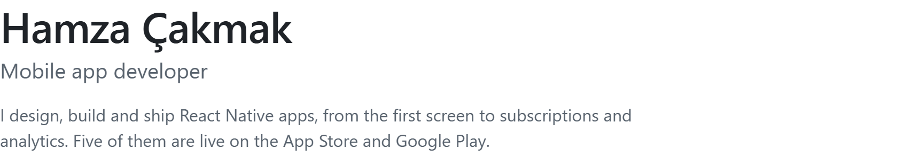
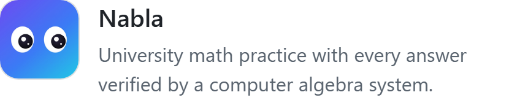

<picture><source media="(prefers-color-scheme: dark)" srcset="assets/profile/intro-dark-v2.png"></picture>

[hamzacakmak833@gmail.com](mailto:hamzacakmak833@gmail.com) · [LinkedIn](https://www.linkedin.com/in/hamzacakmakk/)

### Selected apps

<a href="https://apps.apple.com/us/app/nabla-college-math-practice/id6796978565"><picture><source media="(prefers-color-scheme: dark)" srcset="assets/profile/nabla-dark-v2.png"></picture></a>
<a href="https://apps.apple.com/us/app/takeover-screen-time-control/id6760352061"><picture><source media="(prefers-color-scheme: dark)" srcset="assets/profile/takeover-dark-v2.png"></picture></a>

<a href="https://apps.apple.com/us/developer/muhammed-hamza-cakmak/id1884048817">+ more</a>

### Stack

<picture><source media="(prefers-color-scheme: dark)" srcset="assets/profile/stack-dark-v2.png"></picture>
