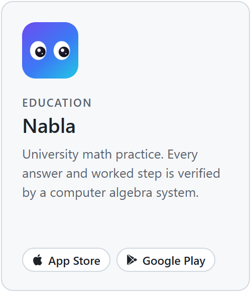
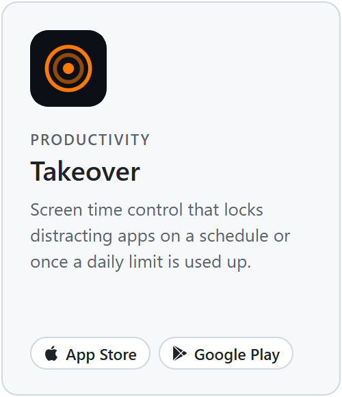
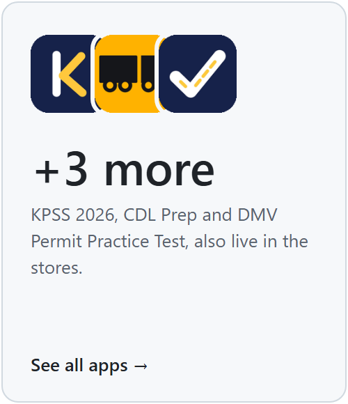

## Hamza Çakmak

I build mobile apps and ship them. My apps are live on the App Store and Google Play, written in
TypeScript with React Native and Expo, with in-app subscriptions and product analytics built in.

### Selected apps

<a href="https://apps.apple.com/us/app/nabla-college-math-practice/id6796978565"><picture><source media="(prefers-color-scheme: dark)" srcset="assets/cards/nabla-dark.png"></picture></a>
<a href="https://apps.apple.com/us/app/takeover-screen-time-control/id6760352061"><picture><source media="(prefers-color-scheme: dark)" srcset="assets/cards/takeover-dark.png"></picture></a>
<a href="https://apps.apple.com/us/developer/muhammed-hamza-cakmak/id1884048817"><picture><source media="(prefers-color-scheme: dark)" srcset="assets/cards/more-dark.png"></picture></a>

### Stack

TypeScript · React Native / Expo · React · Python · Swift · FastAPI · RevenueCat · PostHog
