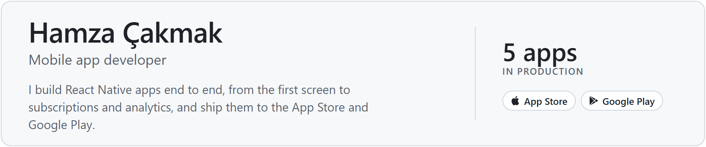
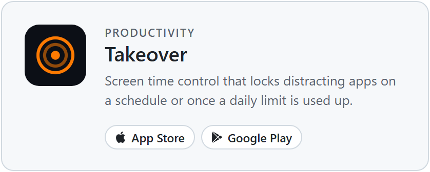

<picture><source media="(prefers-color-scheme: dark)" srcset="assets/profile/header-dark.png"></picture>

### Selected apps

<a href="https://apps.apple.com/us/app/nabla-college-math-practice/id6796978565"><picture><source media="(prefers-color-scheme: dark)" srcset="assets/profile/nabla-dark.png"></picture></a>
<a href="https://apps.apple.com/us/app/takeover-screen-time-control/id6760352061"><picture><source media="(prefers-color-scheme: dark)" srcset="assets/profile/takeover-dark.png"></picture></a>

<a href="https://apps.apple.com/us/developer/muhammed-hamza-cakmak/id1884048817">+ more</a>

### Stack

<picture><source media="(prefers-color-scheme: dark)" srcset="assets/profile/stack-dark.png"></picture>
